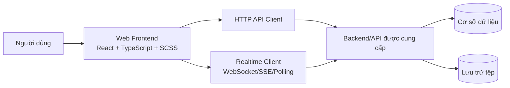

# AppChat — Hệ thống nhắn tin trực tuyến trên nền tảng Web

> **Tài liệu:** README & đặc tả tổng quan hệ thống (System Overview & Requirements Specification)  
> **Phiên bản tài liệu:** 1.0 — 01/11/2026  
> **Trạng thái dự án:** Đã có nguyên mẫu giao diện React; các chức năng nghiệp vụ và tích hợp Backend/API **chưa triển khai**.  
> **Repository:** [NhatAnh05/AppChat](https://github.com/NhatAnh05/AppChat)

## 1. Giới thiệu

**AppChat** là dự án ứng dụng nhắn tin trên Web, hướng đến việc hỗ trợ người dùng trao đổi thông tin theo thời gian thực qua hội thoại cá nhân và nhóm. Sản phẩm được định hướng theo trải nghiệm quen thuộc của các ứng dụng nhắn tin hiện đại: truy cập nhanh danh sách hội thoại, gửi và nhận tin nhắn, quản lý thành viên, chia sẻ tệp, nhận thông báo, tìm kiếm lịch sử trao đổi và quản lý tài khoản.

Dự án hiện tập trung **thiết kế giao diện Frontend** bằng **React + TypeScript + SCSS**. Backend và bộ API sẽ được cung cấp sau; vì vậy tài liệu này mô tả **toàn bộ hệ thống mục tiêu** để làm cơ sở phân tích, phân chia công việc, triển khai và kiểm thử, **không phải tuyên bố tất cả chức năng đã hoàn thiện**.

### 1.1. Mục tiêu

- Xây dựng nền tảng giao tiếp trực tuyến thuận tiện, có cấu trúc và dễ mở rộng.
- Hỗ trợ nhắn tin cá nhân/nhóm, đồng bộ lịch sử và các trạng thái gửi, nhận, đọc.
- Tạo giao diện trực quan, responsive, sử dụng tốt trên máy tính và thiết bị di động.
- Phân tách tầng trình bày, xử lý trạng thái và giao tiếp API để tích hợp Backend do bên cung cấp xác định.
- Chú trọng xác thực, quyền truy cập, tính riêng tư, kiểm soát lỗi và khả năng sử dụng.

### 1.2. Phạm vi và giả định

**Trong phạm vi mục tiêu:** tài khoản, hồ sơ, danh bạ, hội thoại riêng/nhóm, tin nhắn văn bản, tệp đính kèm, tìm kiếm, thông báo, trạng thái hoạt động và quản lý hội thoại. Những chức năng phụ thuộc API/SDK cụ thể (gọi thoại/video, push notification, kiểm duyệt, mã hóa đầu cuối) được xem là **mở rộng có điều kiện**.

**Ràng buộc hiện tại:** chưa có đặc tả API chính thức, chưa xác nhận hệ quản trị dữ liệu, phương thức xác thực, giao thức realtime, lưu trữ file, phân quyền quản trị hoặc hạ tầng triển khai. Các endpoint, entity và luồng kỹ thuật ở dưới là **đề xuất phân tích**, có thể thay đổi khi nhận hợp đồng Backend.

---

## 2. Đối tượng sử dụng và vai trò

| Vai trò | Mô tả | Phạm vi quyền dự kiến |
|---|---|---|
| Khách chưa đăng nhập | Người truy cập hệ thống nhưng chưa xác thực | Xem trang giới thiệu, đăng nhập/đăng ký nếu API hỗ trợ; không đọc tin nhắn riêng tư |
| Người dùng đã đăng nhập (`USER`) | Thành viên sử dụng ứng dụng | Quản lý hồ sơ của mình; trao đổi với các đối tượng được phép; quản lý hội thoại và thông báo của mình |
| Chủ sở hữu/quản trị nhóm (`GROUP_OWNER`/`GROUP_ADMIN`) | Thành viên có quyền quản lý một nhóm cụ thể | Đổi thông tin nhóm, mời/xóa thành viên và phân quyền **nếu Backend hỗ trợ** |
| Quản trị hệ thống (`SYSTEM_ADMIN`) — tùy chọn | Vận hành và xử lý báo cáo vi phạm | Chỉ bổ sung khi đề bài/API có vai trò quản trị; không mặc định được đọc nội dung riêng tư |

**Nguyên tắc phân quyền:** máy chủ phải xác minh danh tính và quyền sở hữu/thành viên ở **mỗi** thao tác; ẩn nút trên giao diện không thay thế kiểm tra quyền tại Backend.

---

## 3. Đặc tả chức năng hệ thống

Các mã `FR` là mã yêu cầu, **không phải mã chức năng đã hoàn thành**.

### 3.1. Tài khoản và xác thực

| Mã | Yêu cầu | Hành vi mong đợi |
|---|---|---|
| FR-A01 | Đăng ký tài khoản | Nhập thông tin cần thiết; kiểm tra hợp lệ và chống trùng danh tính theo quy định của Backend |
| FR-A02 | Đăng nhập | Xác thực tài khoản; nhận phiên hoặc token hợp lệ |
| FR-A03 | Đăng xuất | Kết thúc phiên; xóa thông tin xác thực khỏi phía client phù hợp cơ chế được chọn |
| FR-A04 | Quên/đặt lại mật khẩu | Thực hiện qua email/OTP/liên kết đặt lại **nếu API cung cấp** |
| FR-A05 | Hồ sơ cá nhân | Xem/sửa tên hiển thị, ảnh đại diện, giới thiệu và tùy chọn riêng tư |
| FR-A06 | Quản lý phiên | Xử lý phiên hết hạn, đăng nhập lại và trạng thái không có quyền |

**Luồng đăng nhập dự kiến:** Người dùng mở trang đăng nhập → nhập thông tin → Frontend kiểm tra định dạng → gọi API xác thực → Backend phản hồi → chuyển vào trang hội thoại; khi xác thực thất bại phải hiện lỗi cụ thể, không tạo phiên giả.

### 3.2. Danh bạ và người dùng

| Mã | Yêu cầu | Hành vi mong đợi |
|---|---|---|
| FR-U01 | Tìm người dùng | Tìm theo tiêu chí Backend cho phép; phân trang nếu kết quả lớn |
| FR-U02 | Xem hồ sơ | Hiện tên, avatar, giới thiệu và trạng thái được phép công khai |
| FR-U03 | Khởi tạo trò chuyện | Bắt đầu hội thoại riêng với người dùng hợp lệ |
| FR-U04 | Quản lý liên hệ | Thêm/xóa liên hệ hoặc gửi lời mời kết bạn **nếu mô hình quan hệ được hỗ trợ** |
| FR-U05 | Chặn/bỏ chặn | Không cho phép tương tác theo chính sách chặn của Backend |

### 3.3. Hội thoại cá nhân

| Mã | Yêu cầu | Hành vi mong đợi |
|---|---|---|
| FR-C01 | Danh sách hội thoại | Hiện tên/avatar, nội dung cuối, thời gian, trạng thái đọc/chưa đọc |
| FR-C02 | Mở hội thoại | Tải lịch sử tin nhắn đúng quyền truy cập |
| FR-C03 | Tạo cuộc trò chuyện riêng | Tái sử dụng hội thoại hiện có nếu chính sách Backend quy định |
| FR-C04 | Ghim/bỏ ghim | Ưu tiên các hội thoại được ghim trong danh sách của riêng người dùng |
| FR-C05 | Lưu trữ/bỏ lưu trữ | Ẩn/khôi phục hội thoại khỏi danh sách chính mà không mặc nhiên xóa lịch sử |
| FR-C06 | Tắt/bật thông báo | Tùy chỉnh thông báo theo hội thoại |
| FR-C07 | Đánh dấu đã đọc/chưa đọc | Cập nhật trạng thái hiển thị và số lượng chưa đọc |
| FR-C08 | Xóa/ẩn hội thoại | Phân biệt xóa phía người dùng và xóa dữ liệu phía máy chủ; cần xác nhận trước thao tác nguy hiểm |

### 3.4. Hội thoại nhóm

| Mã | Yêu cầu | Hành vi mong đợi |
|---|---|---|
| FR-G01 | Tạo nhóm | Đặt tên, chọn thành viên hợp lệ, tạo hội thoại loại `GROUP` |
| FR-G02 | Danh sách thành viên | Hiển thị thành viên và vai trò trong nhóm |
| FR-G03 | Mời/thêm thành viên | Kiểm tra quyền và giới hạn số lượng theo Backend |
| FR-G04 | Rời nhóm | Thành viên được rời nhóm; xử lý riêng trường hợp chủ nhóm |
| FR-G05 | Quản lý nhóm | Sửa tên/ảnh, xóa thành viên, đổi quyền nếu được phân quyền |
| FR-G06 | Thông báo thay đổi | Hiện tin hệ thống khi thêm/rời nhóm, đổi tên, đổi quyền nếu API phát sự kiện |

### 3.5. Tin nhắn

| Mã | Yêu cầu | Hành vi mong đợi |
|---|---|---|
| FR-M01 | Gửi tin nhắn văn bản | Không chấp nhận nội dung rỗng; tạo tin qua Backend và cập nhật giao diện |
| FR-M02 | Nhận tin nhắn | Hiển thị tin mới và cập nhật hội thoại liên quan |
| FR-M03 | Xem lịch sử | Tải tin có phân trang/cursor; giữ đúng thứ tự và mốc thời gian |
| FR-M04 | Trạng thái tin nhắn | Hiển thị đang gửi/đã gửi/đã nhận/đã đọc/thất bại **theo dữ liệu thực tế được API hỗ trợ** |
| FR-M05 | Trả lời tin nhắn | Gắn tham chiếu đến tin gốc; xử lý trường hợp tin gốc đã bị xóa |
| FR-M06 | Sửa tin nhắn | Chỉ chủ tin được sửa, trong giới hạn thời gian/chính sách Backend |
| FR-M07 | Thu hồi/xóa tin nhắn | Phân biệt thu hồi cho mọi người và xóa ở phía bản thân nếu Backend hỗ trợ |
| FR-M08 | Thả/bỏ cảm xúc | Hiển thị danh sách cảm xúc, tránh cộng trùng của một người theo quy tắc sản phẩm |
| FR-M09 | Chuyển tiếp | Gửi bản sao/tham chiếu sang hội thoại đích nếu API cho phép |
| FR-M10 | Đang nhập (`typing`) | Hiển thị trạng thái tạm thời, tự hết hạn và không lưu thành tin nhắn |
| FR-M11 | Tin nhắn thất bại | Có thông báo lỗi và thao tác gửi lại; tránh tạo bản ghi trùng |

**Luồng gửi tin:** Nhập nội dung → nhấn Gửi/Enter → tạo trạng thái đang gửi ở client → gửi yêu cầu có định danh chống gửi trùng (nếu API hỗ trợ) → Backend kiểm tra quyền, lưu dữ liệu → phản hồi thành công/thất bại → cập nhật trạng thái; người nhận nhận sự kiện hoặc dữ liệu mới. **Không xem “tin đã xuất hiện trên giao diện” là bằng chứng đã lưu thành công.**

### 3.6. Tệp, ảnh và phương tiện

| Mã | Yêu cầu | Hành vi mong đợi |
|---|---|---|
| FR-F01 | Gửi ảnh | Chọn ảnh, xem trước, kiểm tra loại/kích thước, tải lên theo API được cấp |
| FR-F02 | Gửi tệp | Chọn tệp, theo dõi trạng thái tải lên, hiển thị thông tin tệp |
| FR-F03 | Xem ảnh | Hiển thị ảnh được phép truy cập, phóng to hoặc tải xuống |
| FR-F04 | Kho tài nguyên hội thoại | Xem danh sách ảnh/tệp đã chia sẻ trong hội thoại |
| FR-F05 | Xử lý lỗi tải lên | Phản hồi khi sai định dạng, quá dung lượng, mất mạng hoặc bị từ chối quyền |

Không giả định có URL lưu trữ công khai. Backend cần bảo vệ quyền truy cập tài nguyên, không tin vào loại file do trình duyệt tự khai báo và tuân thủ giới hạn kích thước được cấu hình.

### 3.7. Tìm kiếm, thông báo và trạng thái

| Mã | Yêu cầu | Hành vi mong đợi |
|---|---|---|
| FR-S01 | Tìm hội thoại | Tìm theo tên người nhận, tên nhóm hoặc tiêu chí có trong API |
| FR-S02 | Tìm tin trong hội thoại | Hiện kết quả, đánh dấu từ khóa và chuyển đến vị trí tin tương ứng |
| FR-S03 | Lọc hội thoại | Tất cả/chưa đọc/nhóm/lưu trữ theo tập dữ liệu người dùng được phép xem |
| FR-N01 | Badge chưa đọc | Cập nhật đúng số tin chưa đọc khi có tin mới/đọc tin |
| FR-N02 | Thông báo trong ứng dụng | Hiển thị nguồn thông báo, nội dung tóm tắt, thời gian và trạng thái |
| FR-N03 | Thiết lập thông báo | Bật/tắt toàn cục và theo hội thoại nếu Backend cung cấp |
| FR-P01 | Online/offline | Hiển thị trạng thái hoạt động dựa trên sự kiện/phản hồi của Backend; tránh khẳng định sai khi mất kết nối |
| FR-P02 | Tự khôi phục kết nối | Khi mạng gián đoạn, kết nối lại và đồng bộ các tin đã bỏ lỡ |

### 3.8. Chức năng mở rộng, chưa chốt phạm vi

- **Gọi thoại/video:** chỉ triển khai nếu có SDK/giao thức phù hợp, cơ chế signaling, phân quyền và xử lý microphone/camera; không thể thực hiện đầy đủ bằng nút giao diện đơn thuần.
- **Thông báo trình duyệt/push:** yêu cầu cấp quyền của người dùng và hỗ trợ Backend/hạ tầng tương ứng.
- **Quản trị và báo cáo vi phạm:** chỉ thiết kế khi đề bài có yêu cầu quản lý người dùng, nội dung hoặc xử lý khiếu nại.
- **Mã hóa đầu cuối (E2EE):** là một kiến trúc bảo mật riêng, không mặc định hiện diện chỉ vì ứng dụng dùng HTTPS.

---

## 4. Các quy tắc nghiệp vụ quan trọng

| Mã | Quy tắc |
|---|---|
| BR-01 | Chỉ người dùng đã xác thực mới được truy cập dữ liệu hội thoại riêng tư. |
| BR-02 | Người gửi phải là thành viên hợp lệ của hội thoại tại thời điểm gửi. |
| BR-03 | Người dùng chỉ được sửa/thu hồi tin do mình gửi, trừ ngoại lệ được quy định rõ bởi Backend. |
| BR-04 | Không cho phép gửi tin trống hoặc tệp không hợp lệ. |
| BR-05 | Hành động xóa tin, xóa hội thoại và lưu trữ hội thoại là các thao tác khác nhau. |
| BR-06 | Tin nhắn có thể được gửi nhiều lần do retry; cần cơ chế chống trùng ở Backend hoặc giao thức. |
| BR-07 | Tin nhắn/đọc tin có thể đến không đúng thứ tự do mạng; client phải đồng bộ theo thông tin được máy chủ xác nhận. |
| BR-08 | Chỉ thành viên được cấp quyền mới có thể thay đổi thông tin và thành viên nhóm. |
| BR-09 | Thông tin trạng thái hoạt động, đã đọc và thông báo phải tuân thủ thiết lập quyền riêng tư. |
| BR-10 | Frontend không được coi dữ liệu tự khai báo như `senderId`, `role` hoặc `isAdmin` là căn cứ cấp quyền. |

---

## 5. Luồng sử dụng chính (Use cases)

### UC-01 — Đăng nhập

- **Tác nhân:** khách chưa xác thực.
- **Tiền điều kiện:** hệ thống xác thực khả dụng; tài khoản hợp lệ.
- **Luồng chính:** mở trang đăng nhập → nhập thông tin → gửi yêu cầu → nhận xác thực thành công → mở màn hình Tin nhắn.
- **Ngoại lệ:** sai thông tin; tài khoản khóa; phiên hết hạn; mạng lỗi.
- **Hậu điều kiện:** người dùng có phiên hợp lệ; không ghi mật khẩu/token vào log.

### UC-02 — Gửi và nhận tin nhắn riêng

- **Tác nhân:** người dùng đã đăng nhập.
- **Tiền điều kiện:** có quyền tham gia hội thoại; API gửi tin khả dụng.
- **Luồng chính:** chọn hội thoại → nhập nội dung → gửi → Backend xác nhận lưu → tin hiển thị với trạng thái phù hợp → người nhận thấy tin mới sau đồng bộ.
- **Ngoại lệ:** hết phiên; mất kết nối; không còn quyền; nội dung không hợp lệ; gửi trùng.
- **Hậu điều kiện:** tin được lưu và có định danh do Backend cấp; UI phản ánh trạng thái thực tế.

### UC-03 — Tạo và quản lý nhóm

- **Tác nhân:** người dùng đã đăng nhập.
- **Tiền điều kiện:** được phép tạo nhóm; người được mời hợp lệ.
- **Luồng chính:** chọn Tạo nhóm → nhập tên, chọn thành viên → xác nhận → tạo nhóm → mở hội thoại nhóm → quản lý thành viên theo quyền.
- **Ngoại lệ:** tên không hợp lệ, thành viên trùng, vượt giới hạn, thiếu quyền.
- **Hậu điều kiện:** nhóm mới có ID và danh sách thành viên được Backend lưu.

### UC-04 — Gửi tệp/ảnh

- **Tác nhân:** thành viên hội thoại.
- **Luồng chính:** chọn tệp → kiểm tra hợp lệ ở client → tải lên theo API → nhận `attachmentId` → gửi tin tham chiếu tệp → hiển thị tin đã xác nhận.
- **Ngoại lệ:** loại tệp bị chặn; quá dung lượng; upload thất bại; phiên hết hạn; lỗi quyền.
- **Hậu điều kiện:** tệp gắn với đúng hội thoại, chỉ người được phép mới truy cập.

### UC-05 — Tìm kiếm lịch sử

- **Tác nhân:** thành viên hội thoại.
- **Luồng chính:** mở tìm kiếm → nhập từ khóa → nhận kết quả được phân trang → chọn kết quả → di chuyển đến tin tương ứng.
- **Ngoại lệ:** không có kết quả, từ khóa rỗng, hội thoại bị xóa hoặc không còn quyền.

---

## 6. Kiến trúc hệ thống mục tiêu

**Kiến trúc dưới đây là phương án đề xuất; Backend thực tế do API được cấp quyết định.**



### 6.1. Phân tầng Frontend dự kiến

```text
UI Components / Pages
       ↓
Hooks và quản lý trạng thái giao diện/nghiệp vụ
       ↓
Service Interfaces + Data Mappers
       ↓
HTTP Client / Realtime Adapter
       ↓
API Backend được cung cấp
```

- **UI Components:** chỉ hiển thị dữ liệu và phát sự kiện người dùng.
- **Hooks/State:** quản lý danh sách, hội thoại hiện tại, trạng thái tải/lỗi và cập nhật dữ liệu.
- **Service Interfaces:** chuẩn hóa lời gọi; tránh đặt endpoint trực tiếp trong từng component.
- **Mappers:** chuyển JSON của Backend thành cấu trúc dữ liệu UI mong đợi.
- **Realtime Adapter:** tiếp nhận sự kiện, đồng bộ sau reconnect và xử lý mất kết nối.

**Lưu ý:** các tầng phía dưới UI **chưa tồn tại trong bản source hiện tại**. Không mặc định sử dụng Axios, Zustand, Redux hay WebSocket cho đến khi có nhu cầu và yêu cầu tích hợp cụ thể.

### 6.2. Tổ chức thư mục đề xuất khi mở rộng

```text
AppChat/
├── src/
│   ├── components/        # Thành phần UI dùng chung
│   ├── pages/             # Trang đăng nhập, chat, hồ sơ, ...
│   ├── data/              # Dữ liệu tĩnh xem trước (giai đoạn UI)
│   ├── features/          # Theo nghiệp vụ: auth, chat, groups, ...
│   ├── hooks/             # Custom hooks (dự kiến)
│   ├── services/          # HTTP/realtime/API adapter (dự kiến)
│   ├── stores/            # Trạng thái ứng dụng (dự kiến)
│   ├── types/             # Kiểu dữ liệu miền nghiệp vụ (dự kiến)
│   ├── styles/            # SCSS, design tokens
│   ├── App.tsx
│   └── main.tsx
├── docs/
│   └── APPCHAT_UI_DESIGN_SPEC.md
├── README.md
├── package.json
└── vite.config.ts
```

Các thư mục ghi **(dự kiến)** không có nghĩa là đã có trong repository.

---

## 7. Mô hình dữ liệu đề xuất

Đây là **mô hình khái niệm phục vụ phân tích**; không phải schema cơ sở dữ liệu đã triển khai.

| Thực thể | Thuộc tính quan trọng (minh họa) | Ý nghĩa |
|---|---|---|
| `User` | `id`, `displayName`, `email?`, `avatarUrl?`, `status`, `createdAt` | Tài khoản người dùng |
| `Conversation` | `id`, `type`, `name?`, `avatarUrl?`, `createdAt`, `updatedAt` | Hội thoại cá nhân hoặc nhóm |
| `ConversationMember` | `conversationId`, `userId`, `role`, `joinedAt`, `lastReadMessageId?`, `mutedUntil?` | Quan hệ thành viên, quyền và trạng thái đọc |
| `Message` | `id`, `conversationId`, `senderId`, `type`, `content?`, `replyToId?`, `createdAt`, `editedAt?`, `deletedAt?` | Tin nhắn đã lưu |
| `Attachment` | `id`, `messageId?`, `name`, `mimeType`, `size`, `storageKey` | Tài nguyên đính kèm |
| `Reaction` | `messageId`, `userId`, `emoji`, `createdAt` | Cảm xúc của người dùng đối với tin |
| `UserConversationPreference` | `userId`, `conversationId`, `pinnedAt?`, `archivedAt?`, `mutedUntil?` | Tùy chọn hội thoại cá nhân |
| `Notification` | `id`, `recipientId`, `type`, `payload`, `readAt?`, `createdAt` | Thông báo trong ứng dụng |
| `Session` | `id`, `userId`, `expiresAt`, `revokedAt?` | Quản lý phiên, nếu Backend lưu trạng thái phiên |

Quan hệ chính: một `User` có thể tham gia nhiều `Conversation`; một `Conversation` có nhiều `ConversationMember` và `Message`; một `Message` thuộc một hội thoại, do một người gửi, có thể có nhiều `Attachment` và `Reaction`. Chỉ mục và ràng buộc duy nhất cần được thiết kế theo lưu lượng và công nghệ Backend thực tế.

### 7.1. Trạng thái tin nhắn (đề xuất)

```text
LOCAL_PENDING ──thành công──> SENT ──đã tới người nhận──> DELIVERED ──đã đọc──> READ
      │
      └──thất bại──> FAILED ──gửi lại──> LOCAL_PENDING
```

Trạng thái `DELIVERED`/`READ` chỉ nên hiển thị nếu Backend xác nhận có hỗ trợ. `EDITED` và `RECALLED` là thuộc tính/sự kiện vòng đời nội dung, không nhất thiết thuộc cùng chuỗi trạng thái giao nhận.

---

## 8. Đặc tả API đề xuất — chờ hợp đồng chính thức

> **Quan trọng:** toàn bộ đường dẫn trong mục này chỉ là **ví dụ đề xuất**, chưa được cung cấp hoặc xác nhận. Không viết Frontend phụ thuộc cứng vào bảng này cho đến khi có Swagger/OpenAPI, Postman Collection hoặc tài liệu Backend chính thức.

| Nhóm | Phương thức | Endpoint minh họa | Chức năng |
|---|---|---|---|
| Auth | `POST` | `/api/auth/login` | Đăng nhập |
| Auth | `POST` | `/api/auth/logout` | Đăng xuất |
| User | `GET` | `/api/users/me` | Hồ sơ cá nhân |
| User | `PATCH` | `/api/users/me` | Cập nhật hồ sơ |
| User | `GET` | `/api/users?query=...` | Tìm người dùng |
| Conversation | `GET` | `/api/conversations` | Danh sách hội thoại |
| Conversation | `POST` | `/api/conversations` | Tạo hội thoại |
| Conversation | `GET` | `/api/conversations/{id}` | Chi tiết hội thoại |
| Group | `POST` | `/api/conversations/{id}/members` | Thêm thành viên |
| Group | `DELETE` | `/api/conversations/{id}/members/{userId}` | Xóa/rời nhóm theo quyền |
| Message | `GET` | `/api/conversations/{id}/messages?cursor=...` | Lấy lịch sử phân trang |
| Message | `POST` | `/api/conversations/{id}/messages` | Gửi tin nhắn |
| Message | `PATCH` | `/api/messages/{id}` | Chỉnh sửa tin |
| Message | `DELETE` | `/api/messages/{id}` | Xóa/thu hồi theo chính sách |
| Message | `POST` | `/api/messages/{id}/reactions` | Thả cảm xúc |
| Read | `POST` | `/api/conversations/{id}/read` | Đánh dấu đã đọc |
| Attachment | `POST` | `/api/attachments` | Upload tệp |
| Notification | `GET` | `/api/notifications` | Lấy thông báo |

### 8.1. Ví dụ cấu trúc phản hồi (minh họa)

```json
{
  "id": "msg_001",
  "conversationId": "conv_001",
  "senderId": "user_001",
  "type": "TEXT",
  "content": "Xin chào!",
  "createdAt": "2026-11-01T08:00:00Z",
  "replyToId": null
}
```

Không suy ra từ ví dụ này rằng Backend sử dụng camelCase, UTC, UUID/string ID hoặc chính xác tên trường như trên. Cần viết **data mapper** sau khi nhận response thật.

### 8.2. Những điểm phải xác nhận khi nhận API

1. **Xác thực:** session cookie, Bearer/JWT, refresh token; xử lý CSRF/CORS và hết hạn phiên.
2. **Định danh:** kiểu ID, format timestamp, timezone, `null`/trường tùy chọn.
3. **Phân trang:** page/size hay cursor; sắp xếp tin mới/cũ.
4. **Realtime:** WebSocket/SSE/polling; tên sự kiện; cách subscribe theo tài khoản và hội thoại.
5. **Tin nhắn:** giới hạn độ dài, chỉnh sửa/thu hồi, trạng thái đã đọc, retry/idempotency.
6. **File:** upload một bước/presigned URL, MIME, dung lượng, auth khi tải về.
7. **Nhóm:** vai trò, thêm/rời/xóa thành viên, giới hạn số người.
8. **Lỗi:** HTTP status, cấu trúc lỗi, rate limit, validation và thông báo cho người dùng.
9. **Quyền riêng tư:** tìm kiếm người dùng, block, presence, quyền truy cập lịch sử.
10. **Môi trường:** base URL, môi trường phát triển/kiểm thử, tài khoản test và tài liệu sử dụng.

---

## 9. Giao diện và trải nghiệm người dùng

### 9.1. Sơ đồ màn hình mục tiêu

| Màn hình | Thành phần chính | Trạng thái trong source hiện tại |
|---|---|---|
| Đăng nhập/đăng ký | Form, validation, lỗi xác thực | **Chưa có** |
| Trang chat | Rail, sidebar, danh sách hội thoại, khung chat | **Có giao diện xem trước** |
| Danh bạ | Danh sách liên hệ, tìm kiếm | **Có giao diện xem trước** |
| Tạo hội thoại | Tìm và chọn người nhận | **Có modal giao diện** |
| Hội thoại nhóm | Thành viên, nhãn nhóm, bảng chi tiết | **Có mẫu hiển thị** |
| Thông tin hội thoại | Thành viên, ảnh/tệp, tùy chọn | **Có giao diện xem trước** |
| Cài đặt | Hồ sơ, thông báo, giao diện, riêng tư | **Có modal giao diện** |
| Gọi thoại/video | Cửa sổ gọi và điều khiển | **Có màn hình minh họa, không có cuộc gọi** |
| Trang lỗi/không có dữ liệu | Loading, empty, 403/404/500, mất kết nối | **Một phần/đề xuất bổ sung** |

### 9.2. Bố cục chuẩn

- **Thanh điều hướng (Rail):** tin nhắn, danh bạ, lưu trữ, cài đặt và tài khoản.
- **Sidebar:** tìm kiếm, bộ lọc, danh sách hội thoại, tin cuối, giờ, chưa đọc và trạng thái chọn.
- **Khu vực chat:** header hội thoại, chuỗi tin nhắn, dấu thời gian, thanh soạn, emoji/tệp và nhóm hành động.
- **Details Panel:** hồ sơ/nhóm, thành viên và tài nguyên đã chia sẻ; có thể mở/đóng.
- **Responsive:** desktop hiển thị đồng thời các vùng; mobile ưu tiên một màn hình danh sách hoặc một màn hình chat, có nút quay lại.

Các trạng thái cần tiếp tục bổ sung khi có xử lý nghiệp vụ: loading/skeleton, gửi thất bại, retry, lỗi upload, không có quyền, offline, mất kết nối realtime, không có kết quả tìm kiếm, nhóm không còn tồn tại.

Xem tài liệu chuyên sâu: [`docs/APPCHAT_UI_DESIGN_SPEC.md`](docs/APPCHAT_UI_DESIGN_SPEC.md).

---

## 10. Yêu cầu phi chức năng (NFR)

Đây là **tiêu chí mục tiêu để nghiệm thu khi có Backend**, chưa phải kết quả đo kiểm của sản phẩm.

| Mã | Nhóm | Tiêu chí đề xuất |
|---|---|---|
| NFR-01 | Responsive | Không tràn ngang ở các kích thước mục tiêu; điều hướng và nhập tin dùng được bằng cảm ứng |
| NFR-02 | Khả dụng | Có trạng thái tải, lỗi, trống, phản hồi thao tác và hỗ trợ thao tác bàn phím |
| NFR-03 | Hiệu năng | Danh sách hội thoại và lịch sử dài sử dụng phân trang hoặc virtual list khi cần; đặt KPI thời gian theo môi trường kiểm thử thực tế |
| NFR-04 | Độ tin cậy | Mất mạng không làm giao diện báo gửi thành công giả; có đồng bộ lại và xử lý gửi lại an toàn |
| NFR-05 | Bảo mật | HTTPS khi triển khai; backend kiểm tra quyền, bảo vệ tệp, chống XSS, chống lộ bí mật |
| NFR-06 | Riêng tư | Không hiển thị tin hay metadata của hội thoại không thuộc quyền; cẩn trọng với log, analytics và cache |
| NFR-07 | Tương thích | Kiểm tra trên phiên bản hiện hành của Chrome, Edge, Firefox và trình duyệt di động mục tiêu |
| NFR-08 | Dễ bảo trì | Phân tách component/service/type; cấu hình theo môi trường; mã nguồn có kiểm tra TypeScript/lint/test |
| NFR-09 | Khả năng mở rộng | Hợp đồng API và sự kiện realtime có versioning, phân trang và chính sách giới hạn tải |

### 10.1. Rủi ro cần xử lý

- API cung cấp có thể thiếu chức năng hoặc cấu trúc khác mô hình đề xuất.
- Trạng thái online/đã đọc thường phụ thuộc hỗ trợ của Backend, không thể suy từ UI.
- Upload file và cuộc gọi là các tính năng có yêu cầu bảo mật/hạ tầng riêng.
- Tin nhắn có thể đến sai thứ tự, bị nhận trùng hoặc thất lạc trong thời gian mất mạng.
- Responsive và accessibility cần được kiểm tra bằng thiết bị/trình duyệt thực tế.

---

## 11. Kế hoạch kiểm thử và tiêu chí nghiệm thu

### 11.1. Các mức kiểm thử dự kiến

- **UI/Component:** render theo state, hoạt động modal, focus, sidebar, responsive, khả năng đọc và thao tác.
- **Unit:** validation, mapper dữ liệu, xử lý state, format thời gian, bộ lọc.
- **Integration:** gọi API, xác thực, gửi tin, phân trang, upload, kiểm tra quyền.
- **End-to-end:** tài khoản A gửi cho B; tạo nhóm; đánh dấu đã đọc; reconnect; lỗi phân quyền; rời nhóm.
- **An toàn:** XSS trong nội dung tin, quyền truy cập hội thoại/tệp, dữ liệu bí mật trong log, upload độc hại và spam/rate limit.

### 11.2. Một số kịch bản kiểm thử tiêu biểu

| ID | Kịch bản | Kết quả mong đợi |
|---|---|---|
| TC-01 | Đăng nhập đúng thông tin | Vào giao diện chat với phiên hợp lệ |
| TC-02 | Đăng nhập sai hoặc hết hạn phiên | Thông báo lỗi phù hợp; không truy cập dữ liệu riêng tư |
| TC-03 | A gửi tin cho B | Tin được xác nhận từ Backend và B nhận được sau đồng bộ |
| TC-04 | Gửi nội dung rỗng | Không tạo tin nhắn |
| TC-05 | Gửi khi mất mạng | Hiện thất bại/đang chờ; không báo đã gửi thành công giả |
| TC-06 | Gửi lại yêu cầu cũ | Không phát sinh tin trùng nếu hợp đồng hỗ trợ idempotency |
| TC-07 | Người ngoài truy cập ID hội thoại | Backend từ chối truy cập |
| TC-08 | Thành viên thường sửa tin người khác | Backend từ chối nếu không có quyền |
| TC-09 | Tạo nhóm, thêm/xóa thành viên | Quyền và danh sách thành viên đúng sau tải lại |
| TC-10 | Upload tệp sai loại/quá giới hạn | Bị chặn với thông báo rõ ràng |
| TC-11 | Tìm kiếm lịch sử dài | Phân trang đúng và mở được tin được chọn |
| TC-12 | Xem trên màn hình mobile | Không tràn ngang; mở chat và quay lại danh sách thuận tiện |

### 11.3. Definition of Done cho một chức năng Backend tích hợp

1. Đã thống nhất endpoint, payload, quyền truy cập và các lỗi dự kiến.
2. UI có loading, empty, success và error states.
3. Xử lý đúng khi API trả lỗi/hết phiên/mất mạng.
4. Không dùng dữ liệu mẫu giả kết quả thành công.
5. Đã kiểm tra quyền ở Backend; không chỉ chặn ở Frontend.
6. Có kiểm thử cho luồng chính và các ngoại lệ quan trọng.
7. Tài liệu README và đặc tả API được cập nhật theo hành vi đã triển khai.

---

## 12. Công nghệ và tình trạng triển khai

### 12.1. Công nghệ hiện có trong repository

| Thành phần | Công nghệ | Mục đích |
|---|---|---|
| UI | React 18 | Component và giao diện |
| Ngôn ngữ | TypeScript | Kiểu dữ liệu và kiểm tra tĩnh |
| Styling | SCSS/Sass | Layout, responsive và design tokens |
| Build/dev | Vite 6 | Dev server và đóng gói Frontend |
| Icons | Lucide React | Biểu tượng giao diện |
| Dữ liệu hiển thị | `src/data/previewContent.ts` | Nội dung tĩnh để xem trước thiết kế |

### 12.2. Bảng trạng thái thực tế

| Hạng mục | Trạng thái | Ghi chú |
|---|---|---|
| Source React + TypeScript + SCSS | **Đã có** | Dự án có thể chạy phần UI |
| Giao diện chat, sidebar, danh bạ, thông tin hội thoại | **Đã có nguyên mẫu** | Chưa kết nối dữ liệu thật |
| Chuyển mục, chọn hội thoại, mở modal | **Có tương tác UI** | State tạm thời để xem trước thiết kế |
| Dữ liệu tĩnh trình bày | **Đã có** | Không phải Mock API |
| Đăng nhập/đăng ký thật | **Chưa có** | Chờ yêu cầu và API |
| Service/API Client/Backend | **Chưa có** | Chưa nhận API |
| Cơ sở dữ liệu | **Chưa có** | Do Backend quyết định |
| Gửi/nhận/lưu lịch sử tin nhắn thật | **Chưa có** | Chờ API và realtime |
| Upload ảnh/tệp thật | **Chưa có** | Chờ API lưu trữ |
| WebSocket/SSE/polling | **Chưa có** | Chọn theo khả năng Backend |
| Gọi thoại/video | **Chưa có** | Hiện chỉ có giao diện minh họa |
| Kiểm thử tích hợp/E2E | **Chưa thực hiện** | Chỉ có thể kiểm tra UI hiện tại |

**Không nhầm lẫn:** `previewContent.ts` chứa dữ liệu **tĩnh phục vụ trình bày**, không phải hệ thống giả lập API hay cơ chế lưu lịch sử. Source hiện tại **không** bao gồm Zustand, Axios, WebSocket, localStorage persistence hoặc Backend.

---

## 13. Cài đặt và chạy giao diện hiện tại

### 13.1. Yêu cầu môi trường

- Node.js phiên bản tương thích với phiên bản Vite đang dùng (ưu tiên Node.js LTS hiện hành).
- npm.
- VS Code, WebStorm hoặc IntelliJ IDEA (tùy chọn).

### 13.2. Cài đặt

Tại thư mục có `package.json`:

```bash
npm install
npm run dev
```

Mở địa chỉ localhost được Vite in ra trong Terminal (thường là `http://localhost:5173/`, có thể khác nếu cổng đang được dùng).

### 13.3. Build

```bash
npm run build
npm run preview
```

Các lệnh trên phục vụ giao diện hiện tại; **không** khởi động server chat thật. Không cần cấu hình API để xem trước UI.

### 13.4. Cấu trúc source hiện tại

```text
AppChat-UI/
├── docs/
│   └── APPCHAT_UI_DESIGN_SPEC.md
├── src/
│   ├── components/
│   │   ├── Avatar.tsx
│   │   ├── Rail.tsx
│   │   ├── Sidebar.tsx
│   │   ├── ChatPanel.tsx
│   │   └── DetailsPanel.tsx
│   ├── data/
│   │   └── previewContent.ts
│   ├── styles/
│   │   └── main.scss
│   ├── App.tsx
│   └── main.tsx
├── index.html
├── package.json
├── tsconfig.json
├── vite.config.ts
└── README.md
```

---

## 14. Lộ trình phát triển đề xuất

| Giai đoạn | Nội dung | Điều kiện hoàn thành |
|---|---|---|
| **GĐ1 — Đặc tả & UI** | Phân tích yêu cầu, UI, responsive, tài liệu thiết kế | Các màn hình và trạng thái được rà soát; chốt phạm vi với giảng viên/nhóm |
| **GĐ2 — Phân tích API** | Nhận Swagger/Postman, lập bảng endpoint–chức năng, đối chiếu thiếu/khác | Có danh sách chức năng Backend hỗ trợ và hợp đồng dữ liệu rõ ràng |
| **GĐ3 — Tích hợp nền tảng** | Auth, API client, mapper, error handling, phiên người dùng | Đăng nhập và tải dữ liệu đúng quyền |
| **GĐ4 — Chat cốt lõi** | Hội thoại, lịch sử, gửi/nhận, trạng thái đọc, đồng bộ | Hai tài khoản chat qua Backend, xử lý lỗi và reconnect |
| **GĐ5 — Chức năng nâng cao** | Nhóm, tìm kiếm, tệp, cảm xúc, thông báo | Chức năng đã chốt hoạt động qua API và có test |
| **GĐ6 — Hoàn thiện** | Kiểm thử E2E, bảo mật, tối ưu, tài liệu triển khai | Đạt tiêu chí nghiệm thu và không còn lỗi nghiêm trọng |

Nếu API không hỗ trợ một chức năng, cần ghi rõ trạng thái **không khả dụng/ngoài phạm vi**, không gắn nút với hành động giả hoặc tự ý dựng Backend thay thế trái yêu cầu bài tập.

---

## 15. Quy ước phát triển và cập nhật tài liệu

- Commit rõ mục đích, có thể dùng tiếng Việt có dấu, ví dụ: `docs: bổ sung đặc tả tổng thể hệ thống AppChat`.
- Không commit `node_modules/`, `dist/`, tệp `.env` chứa khóa bí mật, token hoặc thông tin đăng nhập.
- Mỗi khi thêm chức năng phải cập nhật mã yêu cầu `FR-*`, trạng thái thực hiện, endpoint thực tế và test case tương ứng.
- Các ví dụ trong README không được dùng để khẳng định hành vi Backend khi chưa được kiểm chứng.
- Xem **README này** để hiểu **toàn bộ hệ thống mục tiêu**; xem [`docs/APPCHAT_UI_DESIGN_SPEC.md`](docs/APPCHAT_UI_DESIGN_SPEC.md) để hiểu **chi tiết thiết kế giao diện**.

## 16. Kết luận

AppChat được định hướng thành **hệ thống nhắn tin Web đầy đủ**, không chỉ là bộ giao diện. Phiên bản hiện tại mới triển khai **lớp trình bày React** nhằm tạo nền tảng cho việc đánh giá UX và tích hợp API sau này. Các phần đăng nhập, hội thoại và nhắn tin thật, realtime, chia sẻ tệp, phân quyền, lưu trữ và kiểm thử nghiệp vụ sẽ được phát triển **sau khi nhận được Backend/API phù hợp** và chốt phạm vi thực hiện.

**Repository:** https://github.com/NhatAnh05/AppChat
